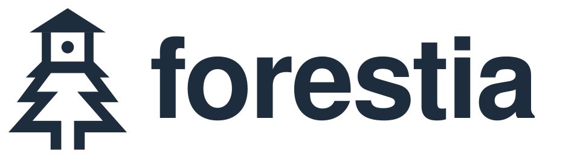
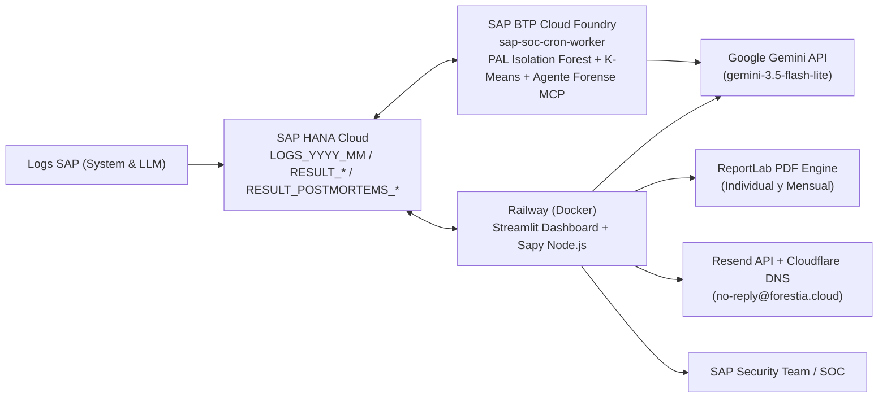

<p align="left">
  
</p>

# Forestia — SAP Cloud Observability & Anomaly Detection

Plataforma end-to-end de observabilidad y seguridad (SOC) para la detección no supervisada de anomalías en logs de **SAP Cloud** (`system` y `llm`), triage forense automatizado con **Agente AI + Model Context Protocol (MCP)**, generación de dossiers **Postmortem en PDF**, envío transaccional por correo y visualización interactiva bilingüe (`ES`/`EN`) con asistente conversacional (**Sapy**).

**Demo en producción:** [https://forestia.cloud](https://forestia.cloud)

---

## Arquitectura General



### Componentes principales

| Capa | Tecnología | Responsabilidad |
|---|---|---|
| **Base de datos y ML in-database** | SAP HANA Cloud + SAP PAL (`hana-ml`) | Almacena logs crudos (`LOGS_YYYY_MM`), calcula ventanas multi-escala en SQL (`5m`, `15m`, `30m`, `1h`, `3h` con 50% traslape), ejecuta **Isolation Forest** y **K-Means** nativos en HANA y persiste `RESULT_*` y `RESULT_POSTMORTEMS_*`. |
| **Worker automatizado** | SAP BTP Cloud Foundry (`src/cron_job_worker.py`) | Daemon sin ruta pública (`no-route: true`) que orquesta Fase 1 (detección ML + clasificación por firmas) y Fase 2 (Agente Forense MCP + Postmortems en HANA + PDF). |
| **Agente Forense MCP** | Python + `mcp_hana_tools.py` + Google Gemini | Deduplica incidentes multi-escala, muestrea evidencia cruda en HANA vía herramientas MCP, mapea tácticas **MITRE ATT&CK** y redacta análisis forense (con respaldo determinístico si no hay LLM). |
| **Dashboard interactivo** | Streamlit (`src/dashboard/dashboard.py`) en Railway | Interfaz bilingüe (`ES`/`EN`) con vista ejecutiva, exploración de anomalías, Postmortems SOC con descarga/envío de PDF, Diagnóstico en vivo (*Health Check* resiliente a instancia HANA apagada) y modo de prueba del pipeline. |
| **Asistente Sapy** | Node.js 22 (`src/chatbot/server.js`) + Gemini | Chatbot contextual integrado en el mismo contenedor de Railway (`localhost:3000`) que responde dudas de navegación y lectura del dashboard con base en `sapy_guia.md`. |
| **Reportes y entrega SOC** | ReportLab + Resend API + Cloudflare DNS | Genera dossiers individuales y mensuales en PDF y los envía desde `no-reply@forestia.cloud` (soporta fallback a Brevo y SMTP). |

---

## Estructura del Repositorio

```text
RetoSAP/
├── .streamlit/config.toml            # Tema visual SAP Horizon (light)
├── .env.example                      # Plantilla de variables de entorno
├── package.json                      # Dependencias Node.js del backend de Sapy
├── requirements.txt                  # Dependencias Python del proyecto completo
├── src/
│   ├── workflow.py                   # Pipeline ML end-to-end (Fase 1)
│   ├── cron_job_worker.py            # Worker daemon programado para SAP BTP CF
│   ├── mcp_hana_tools.py             # Capa de herramientas MCP sobre SAP HANA Cloud
│   ├── agente_forense_postmortem.py  # Agente Forense con Gemini + respaldo determinístico
│   ├── generador_pdf_postmortem.py   # Generador PDF corporativo (ReportLab)
│   ├── traducir_postmortems.py       # Traducción de postmortems ES <-> EN
│   ├── helpers/                      # Módulos del pipeline (conexión, ventanas, PAL, firmas, correo, i18n)
│   ├── chatbot/server.js             # Backend Node.js del asistente Sapy
│   ├── cf_deployment/                # Manifiesto, Procfile, requirements ligeros y deploy script para BTP CF
│   └── dashboard/                    # App Streamlit, Dockerfile multi-stage, start.sh y componentes
└── sandbox/                          # Notebooks exploratorios y experimentos de desarrollo
```

---

## Inicio Rápido (Desarrollo Local)

### 1. Requisitos previos
- **Python 3.12+**
- **Node.js 22+** (para el backend del chatbot Sapy)
- Acceso a una instancia de **SAP HANA Cloud** y clave de **Google Gemini API**

### 2. Configuración de entorno
Copia la plantilla y completa tus credenciales (nunca subas `.env` al repositorio):

```bash
cp .env.example .env
```

Variables principales:

| Variable | Uso |
|---|---|
| `HANA_ADDRESS`, `HANA_PORT`, `HANA_USER`, `HANA_PASSWORD` | Conexión segura a SAP HANA Cloud |
| `GEMINI_API_KEY`, `GEMINI_MODEL` | Agente Forense Postmortem y asistente Sapy (default: `gemini-3.5-flash-lite`) |
| `CHATBOT_URL`, `CHATBOT_PORT` | Comunicación Streamlit -> Sapy (default: `http://localhost:3000/api/chat`) |
| `EMAIL_PROVIDER`, `RESEND_API_KEY`, `EMAIL_FROM` | Envío de dossiers PDF por correo (`auto`, `resend`, `brevo` o `smtp`) |
| `TABLA_DEFAULT`, `CRON_INTERVAL_MINUTES` | Tabla objetivo y cadencia del worker en Cloud Foundry |

### 3. Ejecutar el Dashboard y Sapy localmente

```bash
# 1. Instalar dependencias Python y Node
pip install -r src/dashboard/requirements.txt
npm ci

# 2. Levantar el backend de Sapy (terminal 1)
node src/chatbot/server.js

# 3. Levantar el dashboard de Forestia (terminal 2)
streamlit run src/dashboard/dashboard.py
```

Si la instancia de SAP HANA Cloud se encuentra detenida, Forestia detecta el estado (`código 1890`) y abre automáticamente la vista de **Health Check**, manteniendo verificados el resto de los servicios (Sapy, Correo PDF, Gemini y Modelo) hasta restablecer la conexión.

### 4. Ejecutar el Pipeline ML + Agente Forense manualmente

```bash
python src/cron_job_worker.py --tabla LOGS_2026_09 --once
```

---

## Despliegue en Producción

### Dashboard + Sapy (Railway)
El contenedor se construye con [src/dashboard/Dockerfile](src/dashboard/Dockerfile) (multi-stage Node 22 + Python 3.12) y arranca ambos procesos mediante [src/dashboard/start.sh](src/dashboard/start.sh), expuesto en dominio propio vía Cloudflare DNS (`https://forestia.cloud`).

### Worker Cron-Job (SAP BTP Cloud Foundry)
Consulta la guía paso a paso de empaquetado, pre-staging y arranque en [src/cf_deployment/README.md](src/cf_deployment/README.md).

---

## Equipo

| Integrante | Matrícula |
|---|---|
| Maria de los Angeles Arango Gonzalez | A00839515 |
| Carolina Elizondo Martínez | A01738407 |
| Maritza Graciela Arango Gonzalez | A00839440 |
| Carla Ivette Duval Lopez | A00840224 |
| Isaac Martinez Trujillo | A01735069 |
| Adrián Alejandro Morales Chévez | A01738047 |
